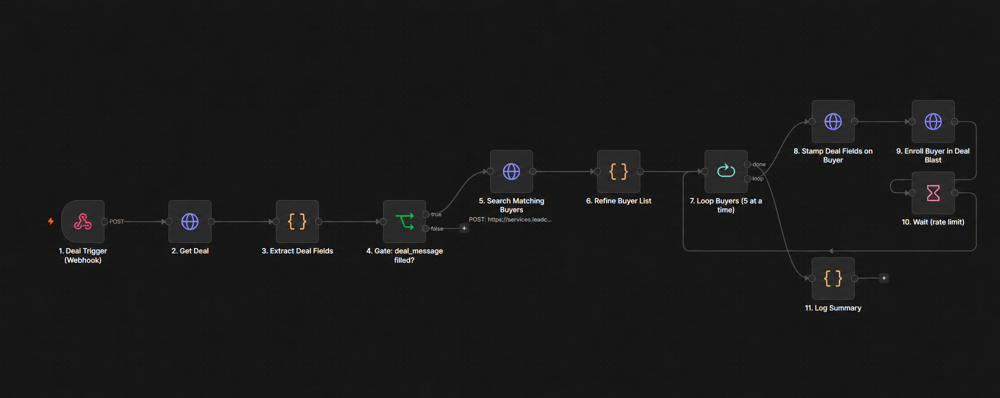

# GoHighLevel CRM Automation with n8n

Webhook-driven CRM automation for matching relevant contacts, updating custom fields, and enrolling contacts into a GoHighLevel follow-up workflow.

**Built by Ali Ahmed Khoso · Automation Engineer**

## What I built

I built the n8n matching and workflow-enrollment component of a larger real estate automation system. This repository focuses on the integration layer: receiving a CRM event, retrieving opportunity data, applying contact-matching logic, and handing matched contacts back to a reusable GHL workflow.

### My contribution

- Created an 11-node n8n workflow using webhooks, HTTP requests, JavaScript, conditional routing, batching, and wait nodes.
- Extracted opportunity custom fields into a consistent data structure.
- Added a gate that requires a populated marketing message before proceeding.
- Prepared contact search filters for active status, state, and property type, with exclusions for active campaigns and do-not-contact tags.
- Implemented county OR ZIP matching in JavaScript, including array and comma-separated field values.
- Configured contact custom-field updates and enrollment into a GHL follow-up workflow.
- Added batches of five, a wait step, and a final summary output.

## Workflow overview

*Presentation image with warning icons removed; it is not execution evidence. The JSON export is the source of truth for connections and configuration.*

| Step | Responsibility |
| --- | --- |
| Webhook | Receive opportunity and location identifiers |
| Get opportunity | Retrieve CRM data through the GHL API |
| Extract fields | Normalize property and campaign information |
| Validation gate | Continue only when the message is populated |
| Search contacts | Request contacts using configured criteria |
| Refine matches | Apply county or ZIP matching |
| Batch loop | Process five contacts at a time |
| Update contact | Stamp current opportunity details on the contact |
| Enroll contact | Start the configured GHL follow-up workflow |
| Wait | Pause before the next batch |
| Summary | Output the opportunity ID, count, and timestamp |

## Technologies

n8n · GoHighLevel / LeadConnector API · JavaScript · REST APIs · JSON · Webhooks · HTTP Header Authentication

## Repository contents

- `workflows/crm-workflow-automation.json` — sanitized n8n export.
- `examples/webhook-payload.json` — placeholder webhook payload.
- `assets/workflow-overview.png` — presentation image.

## Setup

1. Import the workflow JSON into n8n. It is inactive by default.
2. Create an n8n Header Auth credential with header name `Authorization` and value `Bearer YOUR_PRIVATE_INTEGRATION_TOKEN`. Select it on all four HTTP Request nodes. Never embed the token in the exported JSON.
3. Replace `YOUR_GHL_WORKFLOW_ID` in the enrollment URL with your destination workflow ID.
4. Configure the required opportunity and contact custom fields. Map the symbolic keys in the export to the actual field identifiers and response formats in your GHL account.
5. Configure GHL to POST the example payload to the n8n webhook when the desired pipeline event occurs.
6. Test with dedicated test contacts before activating the workflow.

### Custom fields used

Opportunity data includes address, county, ZIP, state, price, property type, beds/baths, property link, marketing message, and showing datetime. Contact matching uses active status, preferred state, property types, counties, and ZIP codes. Contact updates include the current opportunity ID and its marketing details.

## Scope and implementation notes

This export contains the n8n integration component. GHL message sequences, reply handling, appointment booking, reminders, and contract handling belong to the larger system and are not included here.

- The export searches one page of up to 100 contacts; pagination is a future improvement.
- The search filter and exclusion payload must be validated against the connected GHL account before deployment.
- The update request replaces its input with an API response. Confirm the enrollment node receives the contact ID; use a linked reference to the batch item if necessary.
- Custom-field extraction assumes `value` and a matching key or ID; adapt the mapping if the account returns a different schema.
- The wait node contains `amount: 2` without an explicit unit. Confirm its unit in your n8n version before relying on its timing.
- The `matched_and_enrolled` summary counts matched items; it is not an independently verified enrollment count.
- Tag-based exclusions depend on the destination GHL workflow setting and clearing the active-campaign tag. Atomic locking, retries, requeueing, and per-contact success tracking are not implemented in this export.
- Showing datetime is extracted but is not included in the exported contact-update payload.

## Suggested validation

Use test data to check the empty-message branch, county-only and ZIP-only matches, exclusion rules, multiple batches, contact field updates, and successful enrollment. Confirm the summary runs after processing completes. No live client execution was performed as part of preparing this repository.

## Privacy

Client names, account identifiers, credentials, and instance metadata are excluded. Configure your own account values after import.
